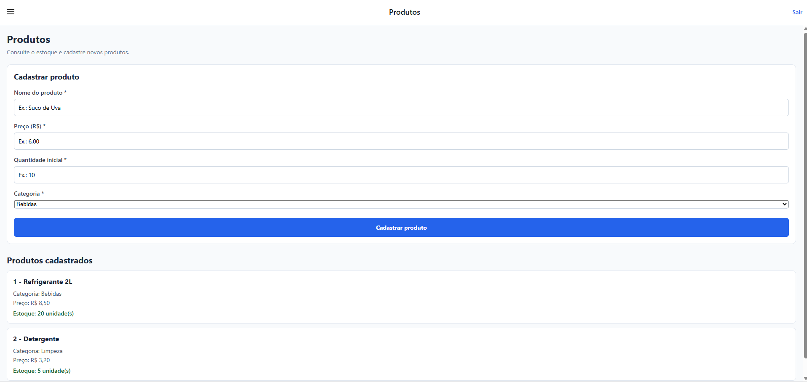
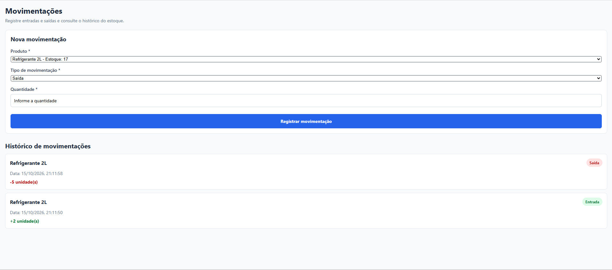
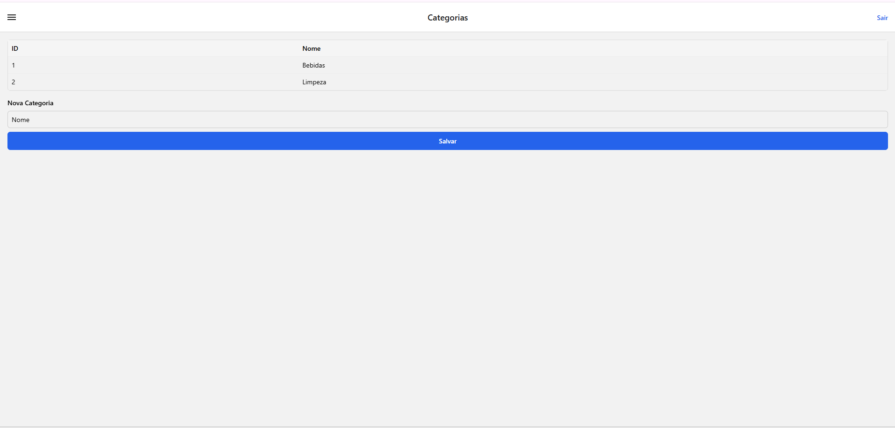

# AppEstoque

Aplicativo desenvolvido em React Native com Expo para controle de estoque, como parte das Atividades 01 e 02 de Dispositivos Móveis.

## Funcionalidades

### Produtos
- Listagem de produtos com ID, nome, categoria, preço e quantidade em estoque.
- Cadastro de produtos com nome, preço, quantidade inicial e categoria.
- Validação dos campos obrigatórios.
- Atualização da lista após o cadastro.

### Movimentações
- Histórico de movimentações com data e hora, produto, tipo e quantidade.
- Registro de entradas e saídas de estoque.
- Exibição do estoque atual na seleção de produtos.
- Validação dos campos e atualização do histórico após o registro.

### Outras funcionalidades
- Listagem e cadastro de categorias.
- Navegação por menu lateral.
- Botão para sair da conta.

## Tecnologias utilizadas

- React Native
- Expo
- TypeScript
- React Navigation
- `@react-native-picker/picker`
- API e dados de exemplo disponibilizados no projeto

## Como executar

1. Clone o repositório e abra a pasta do projeto.
2. Entre na pasta do frontend:

   ```bash
   cd frontend
   ```

3. Instale as dependências:

   ```bash
   npm install
   ```

4. Inicie o Expo:

   ```bash
   npm start
   ```

Para executar no navegador, use `npm run web`. Para verificar os tipos TypeScript:

```bash
npx tsc --noEmit
```

## Capturas de tela

### Tela de Produtos



### Tela de Movimentações



### Tela de Categorias



## Estrutura do projeto

```text
appEstoque/
├── frontend/
│   ├── src/
│   │   ├── api/
│   │   ├── components/
│   │   ├── context/
│   │   ├── navigation/
│   │   ├── screens/
│   │   └── types/
│   ├── App.tsx
│   └── package.json
├── screenshots/
│   ├── produtos.png
│   ├── movimentacoes.png
│   └── categorias.png
└── README.md
```

## Observação

Não é necessário versionar a pasta `node_modules`. Ela é recriada localmente com `npm install`.
